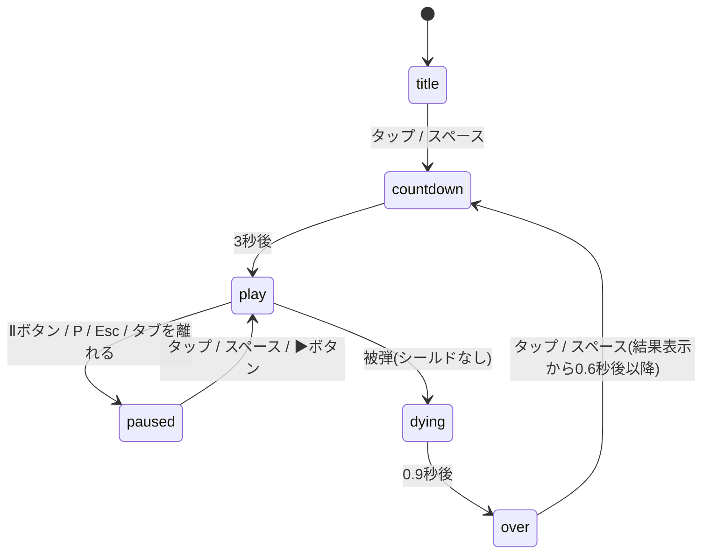

# よけゲー 設計書

最終更新: 2026-10-12 / 対象: `main` の実装

## 1. 全体構成

サーバーを持たない静的サイトです。ブラウザだけで完結し、外部ライブラリや外部への通信はありません。

| ファイル | 役割 |
|---|---|
| `index.html` | Canvas と右上のボタン(一時停止・消音)を置く。CSP を `<meta>` で指定 |
| `style.css` | 画面中央への配置、背景色、ボタンの見た目、スクロールやズームの抑止 |
| `game.js` | ゲームのすべて(状態、入力、更新、描画、効果音、保存) |
| `.nojekyll` | GitHub Pages で Jekyll による変換を行わないための空ファイル |
| `docs/` | 本資料 |

`game.js` は即時実行関数で全体を包み、グローバル変数を作りません(動作確認用の `window.__dodge` だけを公開)。

## 2. 画面サイズ

- 論理解像度は **360 × 640** の縦長に固定し、ゲームの座標はすべてこの単位で扱う。
- 実際の表示は、ウィンドウに収まる最大の倍率で拡大縮小する(`fit()`)。
- 高解像度の画面では `devicePixelRatio` を掛けた大きさで描画し、文字や図形をくっきり見せる。

## 3. 画面遷移(シーン)

`state.scene` で現在の画面を管理します。



| シーン | 内容 |
|---|---|
| `title` | ロゴ、自機のデモ、スタートボタン、図形ずかん。背景を図形が漂う |
| `countdown` | 3・2・1 を表示。自機は動かせるが、障害物はまだ出ない |
| `play` | 本編 |
| `paused` | 更新を止め、半透明の幕と「一時停止中」を表示 |
| `dying` | 自機が砕ける演出。障害物を通常の 0.2 倍の速さで動かす |
| `over` | ランク、スコア、成績、「もう一度」ボタン |

結果画面の直後に誤ってタップしても再開しないよう、0.6秒間は入力を受け付けません。

## 4. メインループ

```
requestAnimationFrame → loop(now)
  dt = 前フレームからの経過秒(最大 0.05 秒に制限)
  update(dt)   状態を進める
  draw()       画面を描く
```

`dt` に上限を設けているのは、タブ復帰時などに経過時間が大きくなり、障害物がすり抜けたり一気に進んだりするのを防ぐためです。

`update(dt)` のおおまかな処理順(`play` のとき):

1. 経過時間 `t` とスコアを進める(1秒 = 10点)
2. レベルの判定(10秒ごと)。上がったらバナーを表示
3. コンボの残り時間を減らし、切れたらコンボを 0 に戻す
4. 自機を移動
5. 出現タイマーが切れたら障害物かアイテムを1つ出す
6. 障害物を移動(ゆらゆらの揺れ、ブンレツの分裂、画面外に出たものの削除)
7. 当たり判定(被弾、シールド、アイテム取得、ニアミス)

粒子、ポップアップ文字、残像、バナーはどのシーンでも `updateEffects()` で進めます。

## 5. 状態(`state`)

| 項目 | 内容 |
|---|---|
| `scene`, `sceneT` | 現在のシーンと、そのシーンに入ってからの秒数 |
| `t`, `score`, `level` | 経過秒、スコア、レベル |
| `best`, `newBest` | ハイスコアと、今回更新したか |
| `coins`, `nearMisses`, `combo`, `maxCombo`, `comboTimer` | 成績とコンボ |
| `player` | 位置 `x`, `y`、シールドの有無、見た目の傾き |
| `things` | 画面上の障害物とアイテムの配列 |
| `particles`, `popups`, `trail`, `banner` | 演出用 |
| `shake`, `flash` | 画面の揺れと白い閃光の残り時間 |
| `stars`, `deco` | 背景の星と、タイトル画面で漂う図形 |

## 6. 障害物とアイテム

`things` の各要素は `kind` で種類を表します。落下速度 `v` は経過時間とともに上がります(7章)。

| kind | 名前 | 大きさ | 速さ | 特徴 |
|---|---|---|---|---|
| `circle` | ボール | 半径 13〜24 | v | 分裂で生まれたものは横にも動き、壁で跳ね返る |
| `triangle` | トゲ | 半径 14 | v × 1.5 | 予告時間ぶん画面の上から出発し、その間「!」を表示 |
| `sweeper` | ヨコギリ | 半径 14 | 横向きに v × 1.1 | 左右どちらかから、自機が動ける高さのどこかを横切る。予告時間ぶん画面の外から出発 |
| `diamond` | ゆらゆら | 半径 14 | v | 振れ幅 40〜70 で左右にゆれる |
| `wall` | カベ | 高さ 16、すき間 90 | v × 0.7 | 予告時間ぶん上から出発し、その間画面上端に警告線 |
| `riser` | ツキアゲ | 半径 14 | 上向きに v × 0.9 | 自機の x 座標 ±70 の位置を狙い、画面の下から突き上げる。予告時間ぶん画面の外から出発 |
| `hexagon` | ブンレツ | 半径 18 | v × 0.8 | 画面の高さ 30〜45% の位置で、半径 11 のボール2つに分裂 |
| `coin` | コイン | 半径 10 | v × 0.8 | 取ると +50点 |
| `shield` | シールド | 半径 12 | v × 0.75 | 取ると次の被弾を1回防ぐ。所持中は出現しない |

出現の抽選は、まずシールド(3%、未所持のときのみ)、次にコイン(12%)、それ以外は経過時間で解放済みの障害物から等確率で選びます。

## 7. 難易度

```
落下速度 v       = 160 + 4 × t        (px/秒、t は経過秒)
出現間隔         = max(0.28, 0.9 − 0.012 × t)   (秒)
レベル           = 1 + floor(t / 10)
```

出現間隔は約52秒で下限の0.28秒に達し、それ以降は落下速度だけが上がり続けます。新しい障害物は10秒ごとに1種類ずつ解放され、60秒で7種類すべてが出そろいます(企画書 5.1)。

画面外に出た障害物は、進む向きに出たときだけ消します(予告のため画面外から出発するものがあるため)。

## 8. 当たり判定

- 自機は見た目 28 × 28 の四角ですが、当たり判定は**半径 9.8 の円**(28 ÷ 2 × 0.7)として扱い、見た目より小さくしています。
- 丸・三角・ひし形・六角形・アイテムも円として判定します(中心間の距離 < 半径の和)。
- カベは、自機の円がカベの帯と縦に重なり、かつすき間に完全には入っていない場合に当たりとします。

### ニアミス

- 当たってはいないが、当たり判定の外側 16px 以内に入った障害物を、1つにつき1回だけニアミスとして数えます。
- カベの場合は、すき間を通る際にすき間の端から 16px 以内を通過したときに数えます。
- 2秒以内に次のニアミスがあるとコンボが増え(最大 x5)、点数は 5 × コンボ数です。

### 被弾時の処理

| 状態 | 結果 |
|---|---|
| シールドあり | シールドが消え、ぶつかった障害物も消える。画面が揺れる |
| シールドなし | `dying` に移り、0.9秒後に結果画面へ |

## 9. 入力

| 入力 | 処理 |
|---|---|
| 矢印キー / W A S D | 押している間 `keys.left` / `right` / `up` / `down` を立てる。斜めは速さが変わらないよう 1/√2 倍にする |
| タッチ・マウス | 見えないスティック。Pointer Events で受け、最初に置いた指(`pointerId`)の位置を中心として記録し、そこからなぞった向きに動かす。中心から 50 で最高速、15% 未満は遊びとして止まる。操作中は画面にスティックの輪とつまみを表示する。2本目以降の指は無視する |
| 反対向きのキーが同時に押された | 打ち消し合って止まる |
| スティックとキーを同時に使った | スティックを優先する |
| ボタン上のタッチ | `stopPropagation` で、移動やゲーム開始の入力として扱わない |
| ウィンドウからフォーカスが外れた | 押しっぱなし状態を全部解除する |

## 10. 音と振動

- 効果音は WebAudio のオシレーターで鳴らし、音声ファイルは使っていません。
- ブラウザの自動再生の制限があるため、`AudioContext` は最初に音を鳴らすとき(利用者の操作のあと)に作ります。
- 振動は `navigator.vibrate` がある端末(主に Android)でのみ動きます。iOS の Safari は対応していません。
- 音や振動が使えない環境でも、例外を握りつぶしてゲームは続行します。

## 11. 保存

ブラウザの localStorage に次の2つだけを保存します。端末ごとの保存で、他の人とは共有されません。

| キー | 内容 |
|---|---|
| `dodge.best` | ハイスコア。読み込み時に 0 以上 1,000万未満の整数でなければ 0 として扱う |
| `dodge.muted` | 消音中なら `"1"` |

プライベートブラウズなどで localStorage が使えない場合も、例外を握りつぶして保存なしで動きます。

## 12. 描画

- 毎フレーム全体を描き直します。描く順番は、背景 → 星 → 障害物 → 予告 → 自機 → 粒子 → 閃光 → スコア表示 → ポップアップ → バナー → シーンごとの重ね表示 です。
- 画面の揺れは、描画全体の原点をランダムにずらして表現します。
- 図形の光は Canvas の `shadowBlur` で付けています。

## 13. 調整値(`TUNE`)

難易度や点数は `game.js` 先頭の `TUNE` にまとめています。値はすべて初期値で、試遊して調整する前提です。

| 名前 | 値 | 意味 |
|---|---|---|
| `playerSpeed` | 300 | 自機の移動速度(px/秒) |
| `playerSize` | 28 | 自機の大きさ |
| `hitboxScale` | 0.7 | 当たり判定を見た目より小さくする割合 |
| `baseFall` / `fallGrowth` | 160 / 4 | 落下速度の初期値と、1秒ごとの増加量 |
| `baseInterval` / `minInterval` / `intervalDecay` | 0.9 / 0.28 / 0.012 | 出現間隔の初期値、下限、1秒ごとの短縮量 |
| `coinChance` / `shieldChance` | 0.12 / 0.03 | コインとシールドの出現確率 |
| `pointsPerSecond` / `coinPoints` | 10 / 50 | 生存とコインの点数 |
| `nearMissDist` / `nearMissPoints` | 16 / 5 | ニアミスの距離と基本点 |
| `comboWindow` / `maxCombo` | 2.0 / 5 | コンボが続く秒数と上限 |
| `levelSeconds` | 10 | レベルが上がる間隔(秒) |
| `playerMinY` | 0.4 | 自機が上に動ける限界(画面の高さに対する割合)。プレイ中はこの高さに点線を表示 |
| `stickRadius` / `stickDeadZone` | 50 / 0.15 | スティックを最大に倒したとみなす距離と、遊びの割合 |
| `warnTime` | 0.6 | トゲとカベの予告時間(秒) |
| `ranks` | S 1000 / A 600 / B 300 / C 0 | ランクのしきい値 |

## 14. 公開とキャッシュ

- `main` ブランチの直下を GitHub Pages で配信しています(Settings → Pages → Deploy from a branch → `main` / `/ (root)`)。
- GitHub Pages はファイルをブラウザにキャッシュさせるため、更新直後は古いファイルが使われることがあります。`index.html` から読み込む `game.js` と `style.css` には `?v=4` のようなバージョン番号を付けています。**`game.js` や `style.css` を変えたときは、この番号を1つ上げてください。**
- `index.html` が古いままでボタンが無い場合も、`game.js` はエラーにならずに動くようにしています。

## 15. 動作確認の方法

自動テストはまだありません。これまでの変更は、ヘッドレス Chromium(Playwright)でページを開き、次のことを確認しています。

- タイトル、カウントダウン、プレイ、一時停止と再開、結果画面への遷移
- キー操作(上下左右・斜め)とスティック操作(マウスとタッチの両方)で自機が動くこと、上に動ける限界で止まること
- 経過時間を進めたときに7種の障害物がすべて出ること、ヨコギリとツキアゲの予告が出ること、ブンレツが分裂すること
- ニアミスが数えられること
- 不正なハイスコアが無視されること
- コンソールにエラーや CSP 違反が出ないこと

動作確認用に `window.__dodge`(`state`, `TUNE`, `start`, `stick`)を公開しています。ブラウザの開発者ツールから、たとえば `__dodge.state.t = 50` とすると50秒時点の難易度を試せます。

## 16. セキュリティ

[security.md](security.md) を参照してください。
